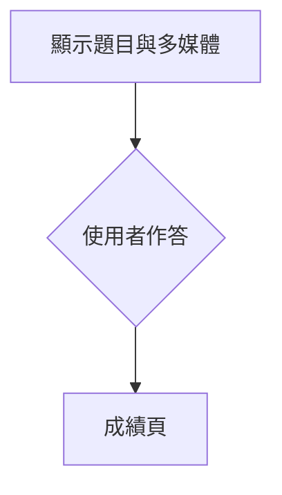

---
title: PBL專題_設計我的多媒體測驗系統.md
tags: [第六周MD]

---

# PBL 專題：設計我的多媒體測驗系統

> **驅動問題**：我要怎麼為一群特定的使用者，設計一個「看得到、聽得到、玩得下去」的多媒體測驗，讓他們在作答中真的學到東西？

| 項目 | 內容 |
|---|---|
| 專題名稱 | （請填寫，例如：台灣鳥類叫聲小偵探） |
| 組員／學號 | 鐘王誠/415730521 |
| 作品網址 | （GitHub Pages 或 NAS 網址，完成後填寫） |
| 使用技術 | p5.js、AI 協作工具（淡小虎） |
| 參考範例 | 多媒體測驗「天氣小達人」 |

---

## 怎麼使用這份文件

1. 把這份 Markdown 複製到你自己的 HackMD，**依照階段一步一步填寫**。
2. 看到「（請填寫）」或空白表格，就換成你自己的內容；灰色引言框裡的文字是**範例**，填完可以刪掉。
3. 每個階段結束前，先完成該階段的**檢核清單**，再進入下一階段。
4. 和 AI 對話的過程，記錄在每個階段的「AI 協作紀錄」裡。這是評分的一部分。

---

## 專題時程

| 階段 | 週次 | 重點 | 繳交內容 |
|---|---|---|---|
| 一、需求分析 | 第 6 週 | 找出使用者、學習目標與學習者特徵 | 預設使用者：國小5年級至國中1年級；學習目標：了解植物構造；學習者特徵：無基礎、無法專注於純文字、對遊戲較有興趣|
| 二、功能設計 | 第 6 週 | 流程圖製作、畫面構想 |畫面：植物:根、莖、葉、花、果實、種子；流程： 
 |
| 三、實作與測試 | 第 6、7 週 | 和 AI 協作寫程式、測試、修正 |畫面：
程式如下附件-1 |
| 四、成品發表 | 第 8 週 | 上線、展示、同儕回饋、反思 | 無 |
附件-1
:::spoiler
```javascript
const W = 900;
const H = 820;

let canvas;
let scaleFactor = 1;

let dragging = null;
let dragFrom = -1;
let submitted = false;
let score = 0;
let startTime;
let endTime;

const parts = [
  {
    name: "花",
    type: "flower",
    x: 450,
    y: 145,
    color: "#e85aad",
    description: "植物的生殖器官，可發育成果實和種子"
  },
  {
    name: "葉",
    type: "leaf",
    x: 330,
    y: 300,
    color: "#2f9e44",
    description: "主要進行光合作用，製造植物所需的養分"
  },
  {
    name: "莖",
    type: "stem",
    x: 450,
    y: 330,
    color: "#a0612d",
    description: "支持植物，並運送水分與養分"
  },
  {
    name: "果實",
    type: "fruit",
    x: 570,
    y: 255,
    color: "#f08c00",
    description: "通常由花的子房發育而成，可保護種子"
  },
  {
    name: "種子",
    type: "seed",
    x: 570,
    y: 385,
    color: "#8d5524",
    description: "含有胚，是植物繁殖與生長的起點"
  },
  {
    name: "根",
    type: "root",
    x: 450,
    y: 490,
    color: "#8d5524",
    description: "固定植物，吸收水分與礦物質"
  }
];

let cards = [];

function setup() {
  canvas = createCanvas(W, H);
  canvas.style("display", "block");
  canvas.style("margin", "0 auto");
  canvas.style("touch-action", "none");

  textFont("Arial, Microsoft JhengHei, sans-serif");

  cards = shuffle(parts.map((part, i) => ({
    name: part.name,
    type: part.type,
    color: part.color,
    homeX: 65 + (i % 3) * 270,
    homeY: 625 + floor(i / 3) * 55,
    x: 65 + (i % 3) * 270,
    y: 625 + floor(i / 3) * 55,
    w: 240,
    h: 40,
    target: -1,
    offsetX: 0,
    offsetY: 0
  })));

  startTime = millis();
  resizeGame();
}

function draw() {
  background("#f3f8f1");

  drawTitle();
  drawPlantArea();
  drawCards();
  drawSubmitButton();

  if (submitted) {
    drawResult();
  }
}

function drawTitle() {
  fill("#24432d");
  noStroke();
  textAlign(CENTER, CENTER);
  textSize(30);
  text("植物構造拖曳配對", W / 2, 40);

  fill("#607568");
  textSize(16);
  text("將下方名稱拖曳到植物正確的部位", W / 2, 78);
}

function drawPlantArea() {
  fill("#ffffff");
  stroke("#c8d8c4");
  strokeWeight(2);
  rect(70, 105, 760, 480, 24);

  drawGround();
  drawPlant();

  for (let i = 0; i < parts.length; i++) {
    drawTarget(parts[i], i);

    let card = cards.find(item => item.target === i);

    if (card && card !== dragging) {
      drawPlacedLabel(card, parts[i]);
    }
  }
}

function drawGround() {
  noStroke();
  fill("#dcefcf");
  rect(90, 435, 720, 125, 18);

  stroke("#9bc58c");
  strokeWeight(3);
  line(90, 435, 810, 435);
}

function drawPlant() {
  let t = frameCount * 0.05;

  // 根部動畫
  stroke("#8d5524");
  strokeWeight(7);

  line(450, 420, 450, 500);
  line(450, 470, 405, 525);
  line(450, 470, 495, 525);
  line(450, 485, 430, 535);
  line(450, 485, 475, 535);

  // 根部閃動小圓點
  noStroke();
  fill("#c08457");

  for (let i = 0; i < 5; i++) {
    let x = 420 + i * 18;
    let y = 505 + sin(t + i) * 8;
    circle(x, y, 7);
  }

  // 莖部呼吸動畫
  let stemSize = 14 + sin(t * 2) * 2;

  stroke("#4d9a45");
  strokeWeight(stemSize);
  line(450, 420, 450, 190);

  // 葉片動畫
  noStroke();
  fill("#52b788");

  let leafMove = sin(t) * 4;

  push();
  translate(350, 285);
  rotate(radians(-8 + leafMove / 3));
  ellipse(0, 0, 150, 65);
  pop();

  push();
  translate(550, 325);
  rotate(radians(8 - leafMove / 3));
  ellipse(0, 0, 150, 65);
  pop();

  push();
  translate(350, 350);
  rotate(radians(-5 + leafMove / 3));
  ellipse(0, 0, 125, 58);
  pop();

  stroke("#2f7d32");
  strokeWeight(4);
  line(450, 320, 355, 285);
  line(450, 350, 550, 325);
  line(450, 370, 360, 350);

  // 果實跳動動畫
  let fruitSize = 52 + sin(t * 2) * 3;

  noStroke();
  fill("#f08c00");
  circle(570, 255, fruitSize);

  fill("#ffb703");
  circle(558, 244, 12);

  // 花朵旋轉動畫
  push();
  translate(450, 145);
  rotate(t * 0.25);

  fill("#e85aad");

  for (let i = 0; i < 5; i++) {
    let angle = TWO_PI * i / 5;
    ellipse(
      cos(angle) * 23,
      sin(angle) * 23,
      42,
      42
    );
  }

  fill("#ffd166");
  circle(0, 0, 28);
  pop();

  // 種子閃爍動畫
  let seedAlpha = 180 + sin(t * 3) * 60;

  fill(255, 243, 191, seedAlpha);
  stroke("#d59b36");
  strokeWeight(2);
  ellipse(570, 385, 78, 45);

  noStroke();
  fill("#8d5524");

  ellipse(555, 385, 18, 28);
  ellipse(580, 385, 18, 28);
  ellipse(605, 385, 18, 28);
}

function drawTarget(part, index) {
  let pulse = 52 + sin(frameCount * 0.06 + index) * 5;

  noFill();
  stroke(part.color);
  strokeWeight(2);
  circle(part.x, part.y, pulse);

  fill(part.color);
  noStroke();
  textAlign(CENTER, CENTER);
  textSize(12);
  text(index + 1, part.x, part.y);

  drawDescription(part);
}

function drawDescription(part) {
  let x;
  let y;

  if (part.type === "flower") {
    x = 545;
    y = 112;
  } else if (part.type === "leaf") {
    x = 105;
    y = 250;
  } else if (part.type === "stem") {
    x = 545;
    y = 320;
  } else if (part.type === "fruit") {
    x = 625;
    y = 220;
  } else if (part.type === "seed") {
    x = 625;
    y = 375;
  } else {
    x = 150;
    y = 490;
  }

  fill(255, 255, 255, 235);
  stroke(part.color);
  strokeWeight(1.5);
  rect(x, y, 190, 46, 8);

  fill("#435466");
  noStroke();
  textAlign(CENTER, CENTER);
  textSize(12);
  text(part.description, x + 8, y + 5, 174, 36);
}

function drawPlacedLabel(card, part) {
  fill("#ffffff");
  stroke(card.color);
  strokeWeight(2);
  rect(part.x - 38, part.y - 14, 76, 28, 8);

  fill("#243447");
  noStroke();
  textAlign(CENTER, CENTER);
  textSize(13);
  text(card.name, part.x, part.y);
}

function drawCards() {
  for (let card of cards) {
    if (card === dragging) continue;

    if (card.target === -1) {
      drawCard(card, card.x, card.y);
    }
  }

  if (dragging) {
    drawCard(
      dragging,
      mouseX / scaleFactor - dragging.offsetX,
      mouseY / scaleFactor - dragging.offsetY
    );
  }
}

function drawCard(card, x, y) {
  fill(card.color);
  stroke("#ffffff");
  strokeWeight(3);
  rect(x, y, card.w, card.h, 12);

  fill("#ffffff");
  noStroke();
  textAlign(CENTER, CENTER);
  textSize(18);
  text(card.name, x + card.w / 2, y + card.h / 2);
}

function drawSubmitButton() {
  fill(submitted ? "#a0aec0" : "#e8590c");
  noStroke();
  rect(W / 2 - 105, 755, 210, 45, 14);

  fill("#ffffff");
  textAlign(CENTER, CENTER);
  textSize(18);
  text("交卷看成績", W / 2, 778);
}

function mousePressed() {
  if (submitted) return;

  let mx = mouseX / scaleFactor;
  let my = mouseY / scaleFactor;

  if (
    mx > W / 2 - 105 &&
    mx < W / 2 + 105 &&
    my > 755 &&
    my < 800
  ) {
    submit();
    return;
  }

  for (let card of cards) {
    let x;
    let y;
    let width;
    let height;

    if (card.target === -1) {
      x = card.x;
      y = card.y;
      width = card.w;
      height = card.h;
    } else {
      let part = parts[card.target];

      x = part.x - 38;
      y = part.y - 14;
      width = 76;
      height = 28;
    }

    if (
      mx >= x &&
      mx <= x + width &&
      my >= y &&
      my <= y + height
    ) {
      dragging = card;
      dragFrom = card.target;

      card.offsetX = mx - x;
      card.offsetY = my - y;

      card.target = -1;
      return;
    }
  }
}

function mouseDragged() {
  if (!dragging) return;

  let mx = mouseX / scaleFactor;
  let my = mouseY / scaleFactor;

  dragging.x = mx - dragging.offsetX;
  dragging.y = my - dragging.offsetY;
}

function mouseReleased() {
  if (!dragging) return;

  let mx = mouseX / scaleFactor;
  let my = mouseY / scaleFactor;

  let target = -1;

  for (let i = 0; i < parts.length; i++) {
    if (
      dist(mx, my, parts[i].x, parts[i].y) < 55
    ) {
      target = i;
      break;
    }
  }

  if (target !== -1) {
    let oldCard = cards.find(card => card.target === target);

    if (oldCard && oldCard !== dragging) {
      if (dragFrom !== -1) {
        oldCard.target = dragFrom;
      } else {
        oldCard.target = -1;
        oldCard.x = oldCard.homeX;
        oldCard.y = oldCard.homeY;
      }
    }

    dragging.target = target;
  } else {
    dragging.target = -1;
    dragging.x = dragging.homeX;
    dragging.y = dragging.homeY;
  }

  dragging = null;
  dragFrom = -1;
}

function submit() {
  submitted = true;
  endTime = millis();
  score = 0;

  for (let card of cards) {
    if (
      card.target !== -1 &&
      card.type === parts[card.target].type
    ) {
      score++;
    }
  }
}

function drawResult() {
  fill(255, 255, 255, 248);
  stroke("#52606d");
  strokeWeight(2);
  rect(W / 2 - 290, 130, 580, 500, 20);

  fill("#243447");
  noStroke();
  textAlign(CENTER, CENTER);

  textSize(30);
  text("答題結果", W / 2, 175);

  textSize(22);
  text(`分數：${score} / 6`, W / 2, 220);

  let seconds = floor((endTime - startTime) / 1000);
  text(`用時：${seconds} 秒`, W / 2, 255);

  textAlign(LEFT, CENTER);
  textSize(17);

  for (let i = 0; i < parts.length; i++) {
    let card = cards.find(item => item.target === i);
    let correct = card && card.type === parts[i].type;

    fill(correct ? "#2f9e44" : "#e03131");

    text(
      `${i + 1}. ${parts[i].name}：${correct ? "答對" : "答錯"}`,
      W / 2 - 180,
      305 + i * 38
    );
  }
}

function resizeGame() {
  scaleFactor = min((windowWidth - 20) / W, 1);

  canvas.style("width", `${W * scaleFactor}px`);
  canvas.style("height", `${H * scaleFactor}px`);
}

function windowResized() {
  resizeGame();
}

function touchStarted() {
  mousePressed();
  return false;
}

function touchMoved() {
  mouseDragged();
  return false;
}

function touchEnded() {
  mouseReleased();
  return false;
}
```
:::

---

# 第一部分：需求分析

## 1-1 我的使用者是誰？

| 項目 | 我的回答 |
|---|---|
| 使用者是誰 | 國小5年級至國中1年級學生 |
| 年齡／程度 | 11-13/無受過對植物構造之教育|
| 在哪裡使用 | 平板、手機、家裡電腦 |
| 一次可以花多少時間 | 1/6至2 分鐘 |
| 他們擅長／不擅長什麼 | 較慢的遊戲學習/純文字學習、打字|

> **範例**：國小三年級學生，在自然課用平板作答，一次約 5 分鐘。認得常見天氣，但還分不清「多雲」和「陰天」，打字慢，比較適合點選。

### 使用者人物誌（Persona）

> 想像一位具體的使用者，幫他取名字，寫下他的一天。

- **名字與身分**：國棟/國小6年級一般生
- **他想學會什麼**：簡明植物構造
- **他現在遇到的困難**：無植物相關知識
- **什麼會讓他放棄**：過多的難度、文字、壓力
- **什麼會讓他想再玩一次**：簡易操作、容易學習

## 1-2 學習目標

> 使用者完成這個測驗後，應該**能做到**什麼？用「能＋動詞」來寫。

1. 能 簡易學習
2. 能 獲得成就感
3. 能 學習植物構造相關知識

## 1-3 現況與問題

| 問題 | 現在怎麼解決 | 不夠好的地方 |
|---|---|---|
| 學生記不住植物構造樣態 | 老師直接講述 | 學生自主學習不足|
| | | |

## 1-4 為什麼要用「多媒體」？

> 說明為什麼這個主題需要動畫、聲音、圖片或影片，而不是只用文字題。

| 媒體 | 能解決的問題 | 在我的測驗裡怎麼用 |
|---|---|---|
| 動畫／GIF |注意力不集中 | 於題目處生成|
| 圖片 |注意力部集中 | 於底圖處生成|

## 1-5 需求清單（MoSCoW 優先順序）

| 優先順序 | 需求 | 原因（對應哪個使用者問題或學習目標） |
|---|---|---|
| **Must** 一定要有 | 題目敘述| 讓使用者容易理解|
| **Must** 一定要有 | 互動功能| 讓使用者容易專注|
| **Should** 應該要有 | 過久未達時提示| 使用者未知曉答案時，應給予鷹架|
| **Could** 有時間再做 | 連結AI做提問功能| 沒錢|
| **Won't** 這次不做 | 錯誤回報及詢問處| 我沒空|

> **範例**：Must：每題作答後立即顯示對錯與解說（學生需要知道為什麼錯）。Won't：登入帳號（三年級學生記不住密碼）。

## 1-6 AI 協作紀錄（需求分析）

| # | 我問 AI 的提示詞 | AI 的建議重點 | 我採用／不採用，原因 |
|---|---|---|---|
| 1 | 5-7年級對植物構造學習需求 | 正處於由具體觀察逐漸發展抽象理解的階段|採用，與事實相符|

> **提示詞範例**：「我要為國小三年級學生設計一個天氣的多媒體測驗，請幫我列出他們可能遇到的學習困難，以及多媒體可以怎麼幫忙。」

### ✅ 第一部分檢核清單

- [✅ ] 寫出明確的使用者，並完成人物誌
- [✅ ] 至少 2 個「能＋動詞」的學習目標
- [✅ ] 說明為什麼需要多媒體（至少 2 種媒體）
- [✅ ] 需求清單有分優先順序，每項都有原因
- [✅ ] 至少 1 筆 AI 協作紀錄

---

# 第二部分：功能設計

## 2-1 選擇互動方式

> 參考三個範例，選一種（或組合）最適合你的使用者的互動方式，並說明原因。

| 互動方式 | 適合的內容 | 我選嗎？ | 原因 |
|---|---|---|---|
| 拖曳配對（連連看） | 名詞與圖像、聲音配對 | ✅ | 答題過於文字化，拼圖玩法較複雜，我以為只能從這三個中選|
| 點選作答（一題一頁） | 看、聽、情境判斷 | ☐ | |
| 答題解鎖（拼圖） | 一組相關概念，完成後有獎勵 | ☐ | |
| 其他（自己設計） | | ☐ | |

## 2-2 功能規格

| 編號 | 功能名稱 | 說明（使用者會看到／做什麼） | 對應需求 | 優先順序 |
|---|---|---|---|---|
| F1 | 題目呈現 | 植物構造畫面(動畫)| 專注力| Must |
| F2 | 作答互動 | 可拖曳之文字框| 遊戲學習| Must |
| F3 | 成績頁 | 顯示成績| 成就感| Must|

## 2-3 操作流程圖

> 用 Mermaid 畫出使用者從開始到結束的流程（HackMD 可以直接顯示）。把下面的範例改成你的流程。
詳細如圖



## 2-4 畫面設計

> 每個主要畫面畫一張草圖（手繪拍照、Figma、簡報都可以），貼上圖片並說明。

| 畫面 | 草圖 | 說明（版面配置、按鈕位置、手機上怎麼排） |
|---|---|---|
| 作答畫面 | 
 | 上方問題，下方選項拖曳格|
| 回饋畫面 | 
 | 選項拖曳格置上方問題|
| 成績畫面 | 
 | 顯示時間分數|

**視覺風格**

| 項目 | 我的設定 |
|---|---|
| 主色／輔色（色碼） | 白、綠(依顯示器可能有不同視覺)|
| 整體感覺（三個形容詞） | 簡單、明瞭、輕鬆|

## 2-5 題目設計

> 至少 6 題。每題都要對應一個學習目標，並寫出解說。

| # | 題型（anim／sound／image／audio／video） | 題目 | 選項 | 正確答案 | 解說 | 對應學習目標 |
|---|---|---|---|---|---|---|
| 1 | 拖曳配對| 花(圖)| 全| 花| 植物的生殖器官，可發育成果實和種子| 遊戲學習|
| 2 | 拖曳配對| 葉(圖)| 全| 葉| 主要進行光合作用，製造植物所需的養分| 遊戲學習|
| 3 | 拖曳配對| 莖(圖)| 全| 莖| 支持植物，並運送水分與養分| 遊戲學習|
| 4 | 拖曳配對| 果實(圖)| 全| 果實| 通常由花的子房發育而成，可保護種子| 遊戲學習|
| 5 | 拖曳配對| 種子(圖)| 全| 種子| 含有胚，是植物繁殖與生長的起點| 遊戲學習|
| 6 | 拖曳配對| 根(圖)| 全| 根| 固定植物，吸收水分與礦物質| 遊戲學習|

**轉成程式的題目資料（範例格式）**

```javascript
onst parts = [
  {
    name: "花",
    type: "flower",
    x: 450,
    y: 145,
    color: "#e85aad",
    description: "植物的生殖器官，可發育成果實和種子"
  },
  {
    name: "葉",
    type: "leaf",
    x: 330,
    y: 300,
    color: "#2f9e44",
    description: "主要進行光合作用，製造植物所需的養分"
  },
  {
    name: "莖",
    type: "stem",
    x: 450,
    y: 330,
    color: "#a0612d",
    description: "支持植物，並運送水分與養分"
  },
  {
    name: "果實",
    type: "fruit",
    x: 570,
    y: 255,
    color: "#f08c00",
    description: "通常由花的子房發育而成，可保護種子"
  },
  {
    name: "種子",
    type: "seed",
    x: 570,
    y: 385,
    color: "#8d5524",
    description: "含有胚，是植物繁殖與生長的起點"
  },
  {
    name: "根",
    type: "root",
    x: 450,
    y: 490,
    color: "#8d5524",
    description: "固定植物，吸收水分與礦物質"
  }
];
```

## 2-6 多媒體素材清單

> 寫出每個素材的來源與授權，**不可以使用沒有授權的素材**。

| 檔名 | 類型 | 用在第幾題／哪裡 | 來源（自製、網址） | 授權方式 |
|---|---|---|---|---|
| 自己生成| 圖片 | 每一題| 自己生成| 無（例如：CC0、CC BY） |


> 免費素材網站參考：Pixabay、Freesound、Mixkit、Unsplash；也可以自己錄音、拍照，或用 p5.js 程式畫動畫、合成聲音。

## 2-7 AI 協作紀錄（功能設計）

| # | 我問 AI 的提示詞 | AI 的建議重點 | 我採用／不採用，原因 |
|---|---|---|---|
| 1 | 改成植物的根、莖、葉、花、果實、種子，背景為一植物圖，植物部件依照背景植物位置擺放，圖片自己生成| 全部程式| 採用，程式無錯誤|
### ✅ 第二部分檢核清單

- [✅ ] 選定互動方式並說明原因
- [✅ ] 功能規格每一項都對應到需求
- [✅ ] 完成流程圖
- [✅ ] 至少 3 張畫面草圖
- [✅ ] 至少 6 題，每題都有解說與對應學習目標
- [✅ ] 素材清單都有來源與授權

---

# 第三部分：實作與測試

## 3-1 開發環境與專案結構

```
我的專案/
├── index.html
├── style.css
├── sketch.js        ← 主要程式
├── libraries/
│   ├── p5.min.js
│   └── p5.sound.min.js
└── media/           ← 我的圖片、聲音、影片
```

## 3-2 開發日誌

> 每次寫程式都記一筆，包含遇到的問題和怎麼解決。

| 日期 | 今天完成什麼 | 遇到的問題 | 怎麼解決（自己查、問 AI、問同學） | 花費時間 |
|---|---|---|---|---|
| 10/28| 擬定題目| 無| 無| 5分鐘|
| 10/29| 程式| 不會寫| 問 AI| 10分鐘|
| 10/30| 最終確認| 這份文件製作耗時| 打字| 1小時|

## 3-3 AI 協作紀錄（實作）

> 記錄**最重要的 3～5 次**對話，特別是 AI 的程式不能用、或你決定修改 AI 程式的時候。

| # | 我的提示詞 | AI 給的結果 | 測試後發現 | 我怎麼處理 |
|---|---|---|---|---|
| 1 | 改成植物的根、莖、葉、花、果實、種子，背景為一植物圖，植物部件依照背景植物位置擺放，圖片自己生成| 程式| 沒問題| 無|
| 2 | 在題目旁增加文字敘述| 程式| 畫面變豐富| 慶祝|
| 3 | 在植物部件上做GIF動畫，並簡化程式，給我完整程式| 程式| 畫面變豐富| 慶祝|

> **好的提示詞包含**：想要的結果、目前的問題、使用環境。例如：「我的 p5.js 測驗在手機上，中文題目會超出畫面，不會換行，請幫我修改 sketch.js 讓文字自動換行。」

## 3-4 程式重點說明

> 挑 2～3 段你覺得最重要的程式碼，說明它在做什麼。**要用自己的話寫**，不能只貼 AI 的說明。

### 重點 1：（例如：判斷答案與計分）

```javascript
// 貼上你的程式碼
let biologyQuestions = [
  {
    question: "植物製造有機養分的作用",
    answer: "光合作用",
    type: "photosynthesis",
    color: "#74c69d"
  },
  {
    question: "人體進行氣體交換的主要器官",
    answer: "肺",
    type: "lung",
    color: "#ff8787"
  },
  {
    question: "血液中負責運送氧氣的細胞",
    answer: "紅血球",
    type: "redBloodCell",
    color: "#e03131"
  },
  {
    question: "人體消化與吸收養分的主要場所",
    answer: "小腸",
    type: "intestine",
    color: "#f4a261",
    gifUrl: "https://upload.wikimedia.org/wikipedia/commons/3/3a/Small_intestine.gif"
  },
  {
    question: "控制細胞活動的構造",
    answer: "細胞核",
    type: "nucleus",
    color: "#9b5de5"
  },
  {
    question: "生物遺傳訊息的基本單位",
    answer: "基因",
    type: "gene",
    color: "#4dabf7"
  }
];
```

說明：題目

### 重點 2：

```javascript
function drawBiologyAnimation(type, cx, cy, size, color) {
  push();
  translate(cx, cy);

  let t = frameCount * 0.04;

  if (type === "photosynthesis") {
    stroke("#40916c");
    strokeWeight(3);
    line(0, size * 0.5, 0, -size * 0.45);

    noStroke();
    fill("#52b788");
    ellipse(-size * 0.18, -size * 0.12, size * 0.65, size * 0.3);
    ellipse(size * 0.18, size * 0.1, size * 0.65, size * 0.3);

    fill("#ffd166");
    circle(size * 0.55 * cos(t), size * 0.55 * sin(t), 14);
  }

  if (type === "lung") {
    let pulse = 1 + sin(t * 2) * 0.08;

    noStroke();
    fill("#ff8787");

    ellipse(
      -size * 0.23,
      0,
      size * 0.48 * pulse,
      size * 0.8 * pulse
    );

    ellipse(
      size * 0.23,
      0,
      size * 0.48 * pulse,
      size * 0.8 * pulse
    );

    stroke("#c92a2a");
    strokeWeight(4);
    line(0, -size * 0.48, 0, size * 0.48);
    line(0, -size * 0.35, -size * 0.25, -size * 0.15);
    line(0, -size * 0.35, size * 0.25, -size * 0.15);
  }

  if (type === "redBloodCell") {
    noStroke();
    fill("#e03131");

    for (let i = 0; i < 5; i++) {
      let angle = t + i * TWO_PI / 5;
      let x = cos(angle) * size * 0.45;
      let y = sin(angle) * size * 0.35;

      ellipse(x, y, size * 0.42, size * 0.25);
    }
  }

  if (type === "intestine") {
    noFill();
    stroke("#f4a261");
    strokeWeight(7);

    beginShape();

    for (let x = -size * 0.6; x <= size * 0.6; x += 5) {
      let y = sin(x * 0.16 + t) * size * 0.25;
      vertex(x, y);
    }

    endShape();
  }

  if (type === "nucleus") {
    let pulse = sin(t) * 3;

    noStroke();
    fill("#d0a2f7");
    circle(0, 0, size * 1.15 + pulse);

    fill("#7b2cbf");
    circle(0, 0, size * 0.45);

    stroke("#9b5de5");
    strokeWeight(2);

    for (let i = 0; i < 6; i++) {
      let angle = i * TWO_PI / 6;

      line(
        cos(angle) * size * 0.25,
        sin(angle) * size * 0.25,
        cos(angle) * size * 0.52,
        sin(angle) * size * 0.52
      );
    }
  }

  if (type === "gene") {
    noFill();
    stroke("#4dabf7");
    strokeWeight(4);

    beginShape();

    for (let y = -size * 0.55; y <= size * 0.55; y += 5) {
      let x = sin(y * 0.12 + t) * size * 0.3;
      vertex(x, y);
    }

    endShape();

    beginShape();

    for (let y = -size * 0.55; y <= size * 0.55; y += 5) {
      let x = -sin(y * 0.12 + t) * size * 0.3;
      vertex(x, y);
    }

    endShape();

    stroke("#74c0fc");
    strokeWeight(2);

    for (let y = -size * 0.4; y <= size * 0.4; y += 12) {
      line(-size * 0.22, y, size * 0.22, y);
    }
  }

  pop();
}
```


說明：畫動畫

## 3-5 測試計畫與結果

### 功能測試

| 編號 | 測試項目 | 操作步驟 | 預期結果 | 實際結果 | 通過？ |
|---|---|---|---|---|---|
| T1 | 測驗 | 完成全部題目 | 答題成功| | ✅ |
| T2 | 互動 | 完成全部題目 | 答題成功 | | ✅ |
| T3 | 計分 | 完成全部題目 | 分數正確 | | ✅ |


### 裝置測試

| 裝置／瀏覽器 | 畫面正常 | 操作正常 | 聲音正常 | 問題說明 |
|---|---|---|---|---|
| 電腦 Chrome | ✅ | ✅ | ✅ | |
| 電腦 edge | ✅ | ✅ | ✅ | |


### 使用者測試（至少找 2 位同學或目標使用者）

| 測試者 | 完成時間 | 分數 | 卡住的地方 | 他的建議 | 我要怎麼改 |
|---|---|---|---|---|---|
|我 |25s| 滿分| 無| 無|無|
| 通識課同學|15s| 滿分| 無| 無|無|

### ✅ 第三部分檢核清單

- [ ✅] 程式可以執行，沒有錯誤
- [ ✅] 開發日誌至少 3 筆
- [ ✅] 至少 3 筆實作 AI 協作紀錄，包含一次自己修改 AI 程式
- [ ✅] 用自己的話說明 2 段程式
- [ ✅] 功能測試全部通過，或說明未通過的原因
- [ ✅] 至少在電腦和手機兩種裝置上測試
- [ ✅] 至少 2 位使用者測試，並依建議修改

---

# 第四部分：成品發表

## 4-1 作品資訊

| 項目 | 內容 |
|---|---|
| 作品網址 | |
| 程式碼（GitHub 或壓縮檔） | |
| 展示影片或 GIF | |
| 題數／題型 |6 |
| 使用的多媒體 |線上網頁、動畫 |
程式碼：
const W = 900;
const H = 820;

let canvas;
let scaleFactor = 1;

let dragging = null;
let dragFrom = -1;
let submitted = false;
let score = 0;
let startTime;
let endTime;

const parts = [
  {
    name: "花",
    type: "flower",
    x: 450,
    y: 145,
    color: "#e85aad",
    description: "植物的生殖器官，可發育成果實和種子"
  },
  {
    name: "葉",
    type: "leaf",
    x: 330,
    y: 300,
    color: "#2f9e44",
    description: "主要進行光合作用，製造植物所需的養分"
  },
  {
    name: "莖",
    type: "stem",
    x: 450,
    y: 330,
    color: "#a0612d",
    description: "支持植物，並運送水分與養分"
  },
  {
    name: "果實",
    type: "fruit",
    x: 570,
    y: 255,
    color: "#f08c00",
    description: "通常由花的子房發育而成，可保護種子"
  },
  {
    name: "種子",
    type: "seed",
    x: 570,
    y: 385,
    color: "#8d5524",
    description: "含有胚，是植物繁殖與生長的起點"
  },
  {
    name: "根",
    type: "root",
    x: 450,
    y: 490,
    color: "#8d5524",
    description: "固定植物，吸收水分與礦物質"
  }
];

let cards = [];

function setup() {
  canvas = createCanvas(W, H);
  canvas.style("display", "block");
  canvas.style("margin", "0 auto");
  canvas.style("touch-action", "none");

  textFont("Arial, Microsoft JhengHei, sans-serif");

  cards = shuffle(parts.map((part, i) => ({
    name: part.name,
    type: part.type,
    color: part.color,
    homeX: 65 + (i % 3) * 270,
    homeY: 625 + floor(i / 3) * 55,
    x: 65 + (i % 3) * 270,
    y: 625 + floor(i / 3) * 55,
    w: 240,
    h: 40,
    target: -1,
    offsetX: 0,
    offsetY: 0
  })));

  startTime = millis();
  resizeGame();
}

function draw() {
  background("#f3f8f1");

  drawTitle();
  drawPlantArea();
  drawCards();
  drawSubmitButton();

  if (submitted) {
    drawResult();
  }
}

function drawTitle() {
  fill("#24432d");
  noStroke();
  textAlign(CENTER, CENTER);
  textSize(30);
  text("植物構造拖曳配對", W / 2, 40);

  fill("#607568");
  textSize(16);
  text("將下方名稱拖曳到植物正確的部位", W / 2, 78);
}

function drawPlantArea() {
  fill("#ffffff");
  stroke("#c8d8c4");
  strokeWeight(2);
  rect(70, 105, 760, 480, 24);

  drawGround();
  drawPlant();

  for (let i = 0; i < parts.length; i++) {
    drawTarget(parts[i], i);

    let card = cards.find(item => item.target === i);

    if (card && card !== dragging) {
      drawPlacedLabel(card, parts[i]);
    }
  }
}

function drawGround() {
  noStroke();
  fill("#dcefcf");
  rect(90, 435, 720, 125, 18);

  stroke("#9bc58c");
  strokeWeight(3);
  line(90, 435, 810, 435);
}

function drawPlant() {
  let t = frameCount * 0.05;

  // 根部動畫
  stroke("#8d5524");
  strokeWeight(7);

  line(450, 420, 450, 500);
  line(450, 470, 405, 525);
  line(450, 470, 495, 525);
  line(450, 485, 430, 535);
  line(450, 485, 475, 535);

  // 根部閃動小圓點
  noStroke();
  fill("#c08457");

  for (let i = 0; i < 5; i++) {
    let x = 420 + i * 18;
    let y = 505 + sin(t + i) * 8;
    circle(x, y, 7);
  }

  // 莖部呼吸動畫
  let stemSize = 14 + sin(t * 2) * 2;

  stroke("#4d9a45");
  strokeWeight(stemSize);
  line(450, 420, 450, 190);

  // 葉片動畫
  noStroke();
  fill("#52b788");

  let leafMove = sin(t) * 4;

  push();
  translate(350, 285);
  rotate(radians(-8 + leafMove / 3));
  ellipse(0, 0, 150, 65);
  pop();

  push();
  translate(550, 325);
  rotate(radians(8 - leafMove / 3));
  ellipse(0, 0, 150, 65);
  pop();

  push();
  translate(350, 350);
  rotate(radians(-5 + leafMove / 3));
  ellipse(0, 0, 125, 58);
  pop();

  stroke("#2f7d32");
  strokeWeight(4);
  line(450, 320, 355, 285);
  line(450, 350, 550, 325);
  line(450, 370, 360, 350);

  // 果實跳動動畫
  let fruitSize = 52 + sin(t * 2) * 3;

  noStroke();
  fill("#f08c00");
  circle(570, 255, fruitSize);

  fill("#ffb703");
  circle(558, 244, 12);

  // 花朵旋轉動畫
  push();
  translate(450, 145);
  rotate(t * 0.25);

  fill("#e85aad");

  for (let i = 0; i < 5; i++) {
    let angle = TWO_PI * i / 5;
    ellipse(
      cos(angle) * 23,
      sin(angle) * 23,
      42,
      42
    );
  }

  fill("#ffd166");
  circle(0, 0, 28);
  pop();

  // 種子閃爍動畫
  let seedAlpha = 180 + sin(t * 3) * 60;

  fill(255, 243, 191, seedAlpha);
  stroke("#d59b36");
  strokeWeight(2);
  ellipse(570, 385, 78, 45);

  noStroke();
  fill("#8d5524");

  ellipse(555, 385, 18, 28);
  ellipse(580, 385, 18, 28);
  ellipse(605, 385, 18, 28);
}

function drawTarget(part, index) {
  let pulse = 52 + sin(frameCount * 0.06 + index) * 5;

  noFill();
  stroke(part.color);
  strokeWeight(2);
  circle(part.x, part.y, pulse);

  fill(part.color);
  noStroke();
  textAlign(CENTER, CENTER);
  textSize(12);
  text(index + 1, part.x, part.y);

  drawDescription(part);
}

function drawDescription(part) {
  let x;
  let y;

  if (part.type === "flower") {
    x = 545;
    y = 112;
  } else if (part.type === "leaf") {
    x = 105;
    y = 250;
  } else if (part.type === "stem") {
    x = 545;
    y = 320;
  } else if (part.type === "fruit") {
    x = 625;
    y = 220;
  } else if (part.type === "seed") {
    x = 625;
    y = 375;
  } else {
    x = 150;
    y = 490;
  }

  fill(255, 255, 255, 235);
  stroke(part.color);
  strokeWeight(1.5);
  rect(x, y, 190, 46, 8);

  fill("#435466");
  noStroke();
  textAlign(CENTER, CENTER);
  textSize(12);
  text(part.description, x + 8, y + 5, 174, 36);
}

function drawPlacedLabel(card, part) {
  fill("#ffffff");
  stroke(card.color);
  strokeWeight(2);
  rect(part.x - 38, part.y - 14, 76, 28, 8);

  fill("#243447");
  noStroke();
  textAlign(CENTER, CENTER);
  textSize(13);
  text(card.name, part.x, part.y);
}

function drawCards() {
  for (let card of cards) {
    if (card === dragging) continue;

    if (card.target === -1) {
      drawCard(card, card.x, card.y);
    }
  }

  if (dragging) {
    drawCard(
      dragging,
      mouseX / scaleFactor - dragging.offsetX,
      mouseY / scaleFactor - dragging.offsetY
    );
  }
}

function drawCard(card, x, y) {
  fill(card.color);
  stroke("#ffffff");
  strokeWeight(3);
  rect(x, y, card.w, card.h, 12);

  fill("#ffffff");
  noStroke();
  textAlign(CENTER, CENTER);
  textSize(18);
  text(card.name, x + card.w / 2, y + card.h / 2);
}

function drawSubmitButton() {
  fill(submitted ? "#a0aec0" : "#e8590c");
  noStroke();
  rect(W / 2 - 105, 755, 210, 45, 14);

  fill("#ffffff");
  textAlign(CENTER, CENTER);
  textSize(18);
  text("交卷看成績", W / 2, 778);
}

function mousePressed() {
  if (submitted) return;

  let mx = mouseX / scaleFactor;
  let my = mouseY / scaleFactor;

  if (
    mx > W / 2 - 105 &&
    mx < W / 2 + 105 &&
    my > 755 &&
    my < 800
  ) {
    submit();
    return;
  }

  for (let card of cards) {
    let x;
    let y;
    let width;
    let height;

    if (card.target === -1) {
      x = card.x;
      y = card.y;
      width = card.w;
      height = card.h;
    } else {
      let part = parts[card.target];

      x = part.x - 38;
      y = part.y - 14;
      width = 76;
      height = 28;
    }

    if (
      mx >= x &&
      mx <= x + width &&
      my >= y &&
      my <= y + height
    ) {
      dragging = card;
      dragFrom = card.target;

      card.offsetX = mx - x;
      card.offsetY = my - y;

      card.target = -1;
      return;
    }
  }
}

function mouseDragged() {
  if (!dragging) return;

  let mx = mouseX / scaleFactor;
  let my = mouseY / scaleFactor;

  dragging.x = mx - dragging.offsetX;
  dragging.y = my - dragging.offsetY;
}

function mouseReleased() {
  if (!dragging) return;

  let mx = mouseX / scaleFactor;
  let my = mouseY / scaleFactor;

  let target = -1;

  for (let i = 0; i < parts.length; i++) {
    if (
      dist(mx, my, parts[i].x, parts[i].y) < 55
    ) {
      target = i;
      break;
    }
  }

  if (target !== -1) {
    let oldCard = cards.find(card => card.target === target);

    if (oldCard && oldCard !== dragging) {
      if (dragFrom !== -1) {
        oldCard.target = dragFrom;
      } else {
        oldCard.target = -1;
        oldCard.x = oldCard.homeX;
        oldCard.y = oldCard.homeY;
      }
    }

    dragging.target = target;
  } else {
    dragging.target = -1;
    dragging.x = dragging.homeX;
    dragging.y = dragging.homeY;
  }

  dragging = null;
  dragFrom = -1;
}

function submit() {
  submitted = true;
  endTime = millis();
  score = 0;

  for (let card of cards) {
    if (
      card.target !== -1 &&
      card.type === parts[card.target].type
    ) {
      score++;
    }
  }
}

function drawResult() {
  fill(255, 255, 255, 248);
  stroke("#52606d");
  strokeWeight(2);
  rect(W / 2 - 290, 130, 580, 500, 20);

  fill("#243447");
  noStroke();
  textAlign(CENTER, CENTER);

  textSize(30);
  text("答題結果", W / 2, 175);

  textSize(22);
  text(`分數：${score} / 6`, W / 2, 220);

  let seconds = floor((endTime - startTime) / 1000);
  text(`用時：${seconds} 秒`, W / 2, 255);

  textAlign(LEFT, CENTER);
  textSize(17);

  for (let i = 0; i < parts.length; i++) {
    let card = cards.find(item => item.target === i);
    let correct = card && card.type === parts[i].type;

    fill(correct ? "#2f9e44" : "#e03131");

    text(
      `${i + 1}. ${parts[i].name}：${correct ? "答對" : "答錯"}`,
      W / 2 - 180,
      305 + i * 38
    );
  }
}

function resizeGame() {
  scaleFactor = min((windowWidth - 20) / W, 1);

  canvas.style("width", `${W * scaleFactor}px`);
  canvas.style("height", `${H * scaleFactor}px`);
}

function windowResized() {
  resizeGame();
}

function touchStarted() {
  mousePressed();
  return false;
}

function touchMoved() {
  mouseDragged();
  return false;
}

function touchEnded() {
  mouseReleased();
  return false;
}
## 4-2 作品截圖

| 作答畫面 | 回饋畫面 | 成績畫面 |
|---|---|---|
 | | | 
 |

## 4-3 功能完成度

已全數完成

## 4-4 作品介紹（給使用者看的說明）

> 用 100～200 字介紹你的作品：給誰用、怎麼玩、可以學到什麼。
本作品適合 5～7 年級學生使用，透過植物構造拖曳配對遊戲，認識根、莖、葉、花、果實和種子的位置與功能。遊戲開始後，學生將下方的植物部件名稱拖曳到植物圖中的正確位置；若放錯，可拖回重新作答，拖到已有名稱的位置則會自動互換。完成後按下「交卷看成績」，即可查看分數、作答時間及各題對錯。學生能在操作中理解植物構造與功能，並建立植物生長、繁殖與生活經驗之間的連結。
（請填寫）

## 4-5 同儕回饋

| 回饋者 | 最喜歡的地方 | 最想改進的地方 | 給幾顆星（1～5） |
|---|---|---|---|
| 匿名C| 互動有趣| 無| 5|
| 匿名W| 無| 圖片太醜| 4|

## 4-6 學習反思

1. **自我覺察**：這個專題中，哪一刻你最挫折？你當時怎麼調整自己的情緒，讓自己繼續做下去？做本文件，請AI協助
2. **自我管理**：你的時程有照計畫進行嗎？如果重來一次，你會怎麼安排？有，在其他刻上做完
3. **和 AI 合作**：AI 在哪些地方幫了大忙？哪一次你決定不照 AI 的建議做？為什麼？程式，最終的前一版，因為無動畫
4. **為使用者著想**：使用者測試後，你做了什麼修改？這個修改怎麼讓使用者更好用？增加動畫，增加辨識度
5. **人際合作**（分組才填）：你們怎麼分工？遇到意見不同時怎麼解決？無
6. **下一步**：如果還有一週，你最想加入什麼功能？AI即時問答

---

## 評分規準

| 向度 | 比重 | 4 優秀 | 3 良好 | 2 尚可 | 1 待加強 |
|---|---|---|---|---|---|
| 需求分析 | 15% | 使用者具體、學習目標明確，需求有優先順序且都有依據 | 使用者與目標清楚，需求有分優先順序 | 使用者或目標模糊 | 沒有需求分析 |
| 功能設計 | 15% | 流程圖、草圖、題目設計完整，且彼此一致 | 設計文件大致完整 | 缺少流程圖或草圖 | 沒有設計就直接寫程式 |
| 多媒體運用 | 15% | 媒體和學習目標緊密結合，有自製素材，授權清楚 | 媒體合適，授權清楚 | 媒體只是裝飾，或授權不清 | 沒有多媒體 |
| 系統功能 | 20% | Must 與 Should 全部完成，各裝置都能正常操作 | Must 全部完成 | 部分 Must 未完成 | 無法執行 |
| 測試與修正 | 10% | 功能、裝置、使用者測試完整，並依結果修改 | 有功能與使用者測試 | 只有簡單測試 | 沒有測試 |
| AI 協作歷程 | 10% | 紀錄完整，能說明取捨理由，並修改過 AI 的程式 | 紀錄完整 | 紀錄零散 | 沒有紀錄 |
| 發表與反思 | 15% | 介紹清楚、反思具體深入，回應同儕回饋 | 介紹與反思都完成 | 反思簡短空泛 | 沒有反思 |

---

## 繳交清單

- [ ] 這份 HackMD（四個部分都填寫完成）
- [ ] 作品網址可以正常開啟
- [ ] 程式碼（`sketch.js` 與 `media/` 資料夾）
- [ ] 展示影片或 GIF（30 秒～2 分鐘）
- [ ] 素材授權清單

